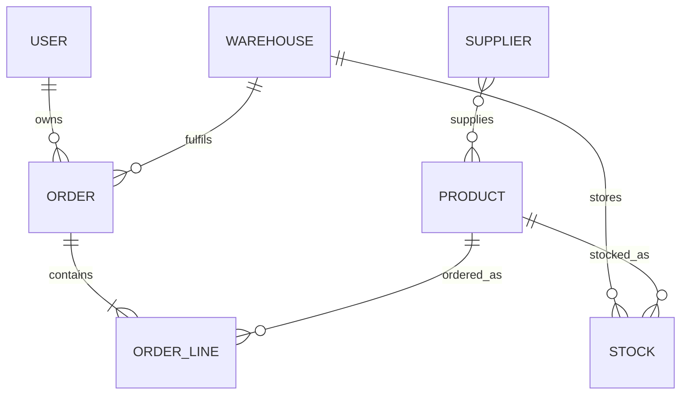

# Halcyon Inventory & Supply Chain Fulfilment API

**Ticket HS-2026-0872 · Odd candidate-ID assignment**

[Repository](https://github.com/theZoid9/halcyon-inventory-api) ·
[CI runs](https://github.com/theZoid9/halcyon-inventory-api/actions) ·
[OpenAPI file](docs/openapi.yaml)

A Django REST service for suppliers, products, warehouse inventory, and customer fulfilment orders.
Standard users manage their own orders; administrators maintain inventory and fulfil allocations.
PostgreSQL transactions prevent overselling and ensure multi-item reservations succeed or fail together.

## Features

- Django 5.2 LTS, Django REST Framework, PostgreSQL configuration, and pinned dependencies.
- Token login/logout and administrator-only user CRUD, including password validation and hashing.
- Standard JSON errors and generated request IDs.
- Database-aware `/health/`, with HTTP 503 when the database is unavailable.
- OpenAPI schema and Swagger UI with bundled static assets.
- Multi-stage non-root Docker image, PostgreSQL Compose stack, and one-shot migration service.
- GitHub Actions lint, migration and schema checks, PostgreSQL tests with an 80% coverage gate,
  followed by an image build and Compose smoke test.
- Six domain models plus Django users, foreign keys, two many-to-many relationships, database
  constraints, and committed migrations.
- Draft order CRUD, allocation, cancellation, administrator fulfilment, and immutable price snapshots.

## Data model and consistency



`Order.products` is an explicit many-to-many relationship through `OrderLine`; products also have
a many-to-many supplier catalogue. Each stock row represents one product in one warehouse.
Users, warehouses, and products referenced by transactions are protected from deletion.

An order starts as `draft`. Its owner may edit its warehouse, reference, and items, or delete it.
`POST allocate/` changes it to `allocated` and increases stock `reserved`; available stock is
`quantity - reserved`. Administrators use `POST fulfil/` to consume both quantity and reserved stock.
`POST cancel/` cancels a draft or releases an allocation. Fulfilled/cancelled orders are retained and
cannot be edited or deleted. Repeating an action that already reached its target state is a no-op;
invalid transitions return 409. Order creation is not idempotent: clients must not blindly retry a
timed-out POST. A production client requiring automatic retries should add an idempotency-key contract.

Order mutations lock the order row, then its warehouse, then stock rows in product-ID order.
Stock creation, quantity updates, and deletion acquire that same warehouse lock. This deliberately
serializes writes within each warehouse, including changes to which stock rows exist; different
warehouses may proceed concurrently. Transactions roll back every reservation if any item is short.
PostgreSQL is required for these concurrency guarantees; SQLite is only a lightweight test option.
Direct SQL/ORM stock mutations bypass this service contract and are unsupported operational writes.

Line prices are copied from the product when a draft line is created or replaced. Subsequent price
changes do not change existing lines. Supplying `items` on PUT/PATCH replaces the whole item list and
captures current prices; a reference-only PATCH preserves prices. Orders accept 1–100 distinct products
with positive integer quantities. Prices use decimal arithmetic in one deployment-wide currency;
tax, shipping, payments, purchasing, returns, and inter-warehouse transfers are outside this ticket.

## Local startup

Requires Docker Engine with Docker Compose v2.

```sh
cp .env.example .env
docker compose up --build -d
docker compose exec app python manage.py createsuperuser
```

In PowerShell, use `Copy-Item .env.example .env` for the first command.
Local example secrets are deliberately public placeholders. Replace both secrets before sharing
or deploying an environment. The database is on the private Compose network; only the app is
bound to localhost. Migrations run once before the app starts, not independently in each worker.

- Health: <http://localhost:8000/health/>
- Swagger UI: <http://localhost:8000/api/docs/>
- OpenAPI: <http://localhost:8000/api/schema/>

```sh
docker compose logs -f app
docker compose down
```

`docker compose down` keeps database data. Adding `--volumes` deletes it.

## Authentication and user administration

Use the administrator created above to sign in. The following examples use a POSIX shell;
on Windows use `curl.exe` and the equivalent PowerShell variable syntax.

```sh
curl -X POST http://localhost:8000/api/auth/login/ \
  -H 'Content-Type: application/json' \
  -d '{"username":"admin","password":"YOUR_ADMIN_PASSWORD"}'

export TOKEN='TOKEN_FROM_LOGIN'
curl http://localhost:8000/api/users/ -H "Authorization: Token $TOKEN"

curl -X POST http://localhost:8000/api/users/ \
  -H "Authorization: Token $TOKEN" -H 'Content-Type: application/json' \
  -d '{"username":"alice","email":"alice@example.com","password":"Replace-with-a-strong-password-123!","is_staff":false}'

curl -X PATCH http://localhost:8000/api/users/2/ \
  -H "Authorization: Token $TOKEN" -H 'Content-Type: application/json' \
  -d '{"email":"alice.updated@example.com"}'

curl -X POST http://localhost:8000/api/auth/logout/ -H "Authorization: Token $TOKEN"
```

Administrators (`is_staff=true`) can list, create, retrieve, PUT/PATCH, and delete users at
`/api/users/` and `/api/users/{id}/`. Standard users cannot access these endpoints.
No public signup or client-supplied privilege escalation endpoint is exposed.
Passwords are write-only. Password changes revoke existing tokens. Inactive users cannot log in.
Tokens remain valid until revoked; logout revokes the user's current token for all clients.
Use HTTPS for all non-local traffic. DRF's process-local login throttle is a basic abuse control;
deploy a shared cache and ingress rate limiting for multiple workers/replicas.

## API and permissions

All domain endpoints require `Authorization: Token <token>`. List endpoints use page-number
pagination (`?page=2`) with 50 rows per page. Orders support `?status=draft|allocated|fulfilled|cancelled`.
Another user's order returns 404 to standard users, including for mutation attempts.

| Resource | Routes | Standard user | Administrator |
| --- | --- | --- | --- |
| Users | `/api/users/`, `/api/users/{id}/` | No access | Full CRUD |
| Suppliers | `/api/suppliers/`, `/api/suppliers/{id}/` | List/retrieve | Full CRUD |
| Products | `/api/products/`, `/api/products/{id}/` | List/retrieve | Full CRUD |
| Warehouses | `/api/warehouses/`, `/api/warehouses/{id}/` | List/retrieve | Full CRUD |
| Stock | `/api/stock/`, `/api/stock/{id}/` | List/retrieve | Full CRUD; reservations are protected |
| Orders | `/api/orders/`, `/api/orders/{id}/` | Own orders; edit/delete drafts | All orders; edit/delete drafts |
| Order lines | Nested `items` in order create/retrieve/PUT/PATCH/delete | Through own draft order | Through any draft order |
| Allocate/cancel | `/api/orders/{id}/allocate/`, `/cancel/` | Own orders | Any order |
| Fulfil | `/api/orders/{id}/fulfil/` | No access | Allocated orders only |
| Login/logout | `/api/auth/login/`, `/api/auth/logout/` | Login is public; logout requires token | Same |
| Monitoring/docs | `/health/`, `/api/schema/`, `/api/docs/` | Public | Public |

Collection CRUD uses GET/POST; detail CRUD uses GET/PUT/PATCH/DELETE. State actions use POST with an
empty body. Owner, status, reserved stock, prices on order lines, totals, IDs, and timestamps are
server-controlled; attempts to write these domain fields return 400. Stock identity is immutable:
create a separate row for a different product or warehouse.

### End-to-end inventory example

Use the administrator's token as `ADMIN_TOKEN` and log in as the created standard user for
`USER_TOKEN`. Examples assume a fresh database where the returned warehouse/product IDs are 1;
otherwise replace IDs with the values returned by each POST.

```sh
export ADMIN_TOKEN='ADMIN_TOKEN_FROM_LOGIN'
export USER_TOKEN='STANDARD_USER_TOKEN_FROM_LOGIN'

curl -X POST http://localhost:8000/api/suppliers/ \
  -H "Authorization: Token $ADMIN_TOKEN" -H 'Content-Type: application/json' \
  -d '{"name":"Acme Supplies","email":"orders@example.com"}'

curl -X POST http://localhost:8000/api/warehouses/ \
  -H "Authorization: Token $ADMIN_TOKEN" -H 'Content-Type: application/json' \
  -d '{"code":"JHB","name":"Johannesburg","address":"1 Example Road"}'

curl -X POST http://localhost:8000/api/products/ \
  -H "Authorization: Token $ADMIN_TOKEN" -H 'Content-Type: application/json' \
  -d '{"sku":"WIDGET-001","name":"Widget","unit_price":"12.50","suppliers":[1]}'

curl -X POST http://localhost:8000/api/stock/ \
  -H "Authorization: Token $ADMIN_TOKEN" -H 'Content-Type: application/json' \
  -d '{"warehouse":1,"product":1,"quantity":100}'

curl -X POST http://localhost:8000/api/orders/ \
  -H "Authorization: Token $USER_TOKEN" -H 'Content-Type: application/json' \
  -d '{"warehouse":1,"reference":"CLIENT-001","items":[{"product":1,"quantity":3}]}'

curl -X PATCH http://localhost:8000/api/orders/1/ \
  -H "Authorization: Token $USER_TOKEN" -H 'Content-Type: application/json' \
  -d '{"reference":"CLIENT-001-APPROVED"}'

curl -X POST http://localhost:8000/api/orders/1/allocate/ -H "Authorization: Token $USER_TOKEN"
curl -X POST http://localhost:8000/api/orders/1/fulfil/ -H "Authorization: Token $ADMIN_TOKEN"
curl http://localhost:8000/api/stock/1/ -H "Authorization: Token $USER_TOKEN"
# quantity=97, reserved=0, available=97

# For another unfulfilled order: cancel an allocation or delete a draft.
curl -X POST http://localhost:8000/api/orders/2/cancel/ -H "Authorization: Token $USER_TOKEN"
curl -X DELETE http://localhost:8000/api/orders/3/ -H "Authorization: Token $USER_TOKEN"
```

## Index choices

| Index / constraint | Why it exists |
| --- | --- |
| Unique `Product.sku`, `Warehouse.code`, `Supplier.name` | Enforces catalogue identity and supports exact lookups without duplicate indexes. Codes are uppercase and validated. |
| Unique stock `(warehouse_id, product_id)` | Prevents duplicate balances and supports the warehouse/product lookup used while reserving inventory. |
| Unique order line `(order_id, product_id)` | Prevents repeated products within one order and supports loading an order's items. |
| Order `(owner_id, created_at DESC, id DESC)` | Supports the standard user's order feed with deterministic newest-first pagination. |
| Order `(status, created_at DESC, id DESC)` | Supports the administrator's status-filtered fulfilment queue. |
| Django's FK and many-to-many indexes | Support joins, ownership checks, relationship traversal, and protected deletion checks. |

No standalone index is added to low-cardinality `is_active` or `status`. The status composite index
also provides useful ordering for filtered queues. PostgreSQL check constraints enforce positive
prices, positive order-line quantities, valid order states, and `0 <= reserved <= quantity`.
The small API does not offer arbitrary substring search; indexes should be re-evaluated using
`EXPLAIN (ANALYZE, BUFFERS)` with representative production data before adding more.

## Error contract

```json
{
  "error": {
    "code": "validation_error",
    "message": "Request validation failed.",
    "details": {"username": ["This field is required."]},
    "request_id": "server-generated-uuid"
  }
}
```

The same request ID is returned in `X-Request-ID`. Unexpected exceptions are logged server-side
and produce a generic 500 response. Uniqueness and protected-relationship conflicts return 409.
Health is a monitoring contract: it returns `status`, `database`, and `uptime_seconds` on both
200 and 503. Uptime measures the current worker's lifetime, not the entire deployment.

## Developer checks

Use Python 3.12 in a virtual environment and install `requirements-dev.txt`.
Set `DJANGO_SECRET_KEY` (at least 50 characters), `DJANGO_ALLOWED_HOSTS`, and PostgreSQL environment
variables matching `.env.example`; set `POSTGRES_HOST=127.0.0.1` when connecting from the host.
Host Python commands do not automatically read `.env`.

```sh
python -m pip install -r requirements-dev.txt
python manage.py check
python manage.py makemigrations --check --dry-run
python manage.py migrate
python manage.py collectstatic --noinput
python manage.py spectacular --file docs/openapi.yaml --validate --fail-on-warn
black --check .
flake8 .
pytest
```

For a lightweight local test run only, explicitly set `USE_SQLITE=true`. PostgreSQL remains
the default and CI uses a disposable PostgreSQL service and Django-created test database.
SQLite verification does not establish PostgreSQL locking or concurrency correctness.
The coverage gate includes branches and excludes generated migrations. Coverage measures executed
code; endpoint and domain behavior tests must also be reviewed for meaningful assertions.

Tests cover every domain model and every CRUD endpoint family, both write methods, authenticated
and unauthenticated access, owner isolation, validation and database constraints, shortages and
transaction rollback, cancellation/fulfilment retries, health failure, token revocation, and errors.
Four PostgreSQL-only tests use independent connections and synchronized threads to exercise competing
allocations, duplicate retries, fulfilment versus cancellation, and stock adjustment versus allocation.
See [verification notes](docs/verification.md) for actual executed results and environment limitations.

## Deployment and submission

The workflow builds and smoke-tests an image after tests pass. It does not push to a registry or
deploy a service: no registry credentials or hosting environment was supplied.
For production, supply secrets through a secret manager, configure allowed hosts and HTTPS at a
trusted ingress, provide database backups and monitoring, and run migrations as a release step.
When using `REQUIRE_HTTPS=true`, configure health probes and trusted proxy handling for your actual
TLS topology; the bundled local HTTP health probe is for the default local stack.

| Deliverable | Current location / status |
| --- | --- |
| GitHub repository | <https://github.com/theZoid9/halcyon-inventory-api> (private; grant the reviewer access) |
| DockerHub image | Not published; optional |
| CI pipeline | `.github/workflows/ci.yml` |
| Swagger | `/api/docs/` when running |
| OpenAPI | `docs/openapi.yaml` and `/api/schema/` |
| Domain / index rationale | Implemented above; models in `core/models.py`, transactions in `core/services.py` |

Design references: [Django 5.2 LTS](https://docs.djangoproject.com/en/5.2/releases/5.2/),
[DRF token authentication](https://www.django-rest-framework.org/api-guide/authentication/),
[DRF permissions](https://www.django-rest-framework.org/api-guide/permissions/).
Database design references: [Django constraints](https://docs.djangoproject.com/en/5.2/ref/models/constraints/)
and [row locking](https://docs.djangoproject.com/en/5.2/ref/models/querysets/#select-for-update).
