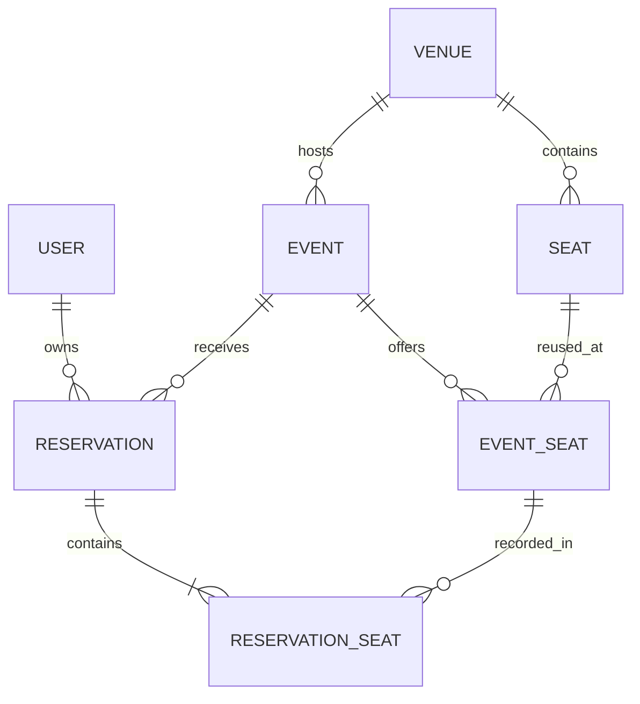

# Halcyon Event Ticketing & Seat Reservation API

**Ticket HS-2026-0872 · Even candidate-ID assignment**

A Django REST API for venues, physical seats, events, event-specific seat prices, and attendee reservations. Standard users browse published events and reserve their own seats. Administrators manage the catalogue and users. PostgreSQL row locks prevent double-booking, and a 15-minute hold expires before another buyer claims a seat.

## Architecture and data model



`Event.seats` is many-to-many through `EventSeat`: the same physical seat may be offered at different events, each with its own price. `Reservation.seats` is many-to-many through `ReservationSeat`, which captures the ticket price at reservation time. An `EventSeat.reservation` pointer records the *current* claimant; the reservation-seat join rows preserve history after cancellation or expiry. Database constraints prevent duplicate physical seat labels, duplicate event/seat pairs, duplicate seats within one reservation, negative prices, and events ending before they start.

### Reservation rules

An administrator creates a draft event, adds event seats, and publishes it. A user selects 1–8 distinct event-seat IDs for a published future event. A successful POST creates a `held` reservation for 15 minutes. `POST confirm/` confirms the hold; it does **not** charge a payment method. A hold can be edited, deleted, or cancelled. A confirmed reservation can be cancelled before the event starts; cancellation releases its seats. Cancelled and expired reservations cannot be confirmed. Event cancellation cancels active reservations and releases all claims.

The service locks the event row before reading or changing reservations and event seats. That serializes claims for one event while allowing different events to proceed independently. Every multi-seat change is atomic: if one seat is unavailable, no seats are claimed. Expired holds are released when an action touches the event; a production scheduler may additionally call an expiry job to update idle events promptly. Availability is checked from the event seat's `is_available`, physical seat's `is_active`, and current claim. The `is_claimed` API field is a snapshot and may change immediately after it is read; clients must handle a 409 conflict on reservation creation.

This ticket does not integrate payments, refunds, admission scanning, taxes, or email delivery. Confirmation represents a booking decision only. A reservation-creation POST is not idempotent; clients should not blindly retry a timed-out POST without an idempotency-key contract.

## Local startup with Docker Compose

Requires Docker Engine with Compose v2. From this repository directory:

```sh
cp .env.example .env
docker compose up --build -d
docker compose exec app python manage.py createsuperuser
```

On Windows PowerShell, use `Copy-Item .env.example .env` for the first command. The `.env.example` secrets are local placeholders: replace the Django secret and database password before sharing or deploying an environment. PostgreSQL data lives in a named volume. The database is private to the Compose network, and the app binds only to localhost. A one-shot migration service runs before the app starts. `docker compose down` keeps database data; `docker compose down --volumes` deletes it.

- Health: <http://localhost:8000/health/>
- Swagger UI: <http://localhost:8000/api/docs/>
- OpenAPI: <http://localhost:8000/api/schema/> and `docs/openapi.yaml`

```sh
docker compose ps
docker compose logs -f app
docker compose down
```

## Authentication and API permissions

Log in with the superuser created above. Send `Authorization: Token <token>` on every protected request. Logging out deletes the token; password changes and user deactivation also revoke it. There is no public signup or client-controlled role escalation. Administrator means Django `is_staff=true`.

| Resource | Routes | Standard user | Administrator |
| --- | --- | --- | --- |
| Users | `/api/users/`, `/api/users/{id}/` | No access | Full CRUD |
| Venues | `/api/venues/`, `/api/venues/{id}/` | Read | Full CRUD |
| Physical seats | `/api/seats/`, `/api/seats/{id}/` | Read | Full CRUD |
| Events | `/api/events/`, `/api/events/{id}/` | Read published events | Full CRUD |
| Event seats | `/api/event-seats/`, `/api/event-seats/{id}/` | Read published-event seats | Full CRUD, subject to active claims and history |
| Reservations | `/api/reservations/`, `/api/reservations/{id}/` | Own reservations; edit/delete active holds | All reservations; edit/delete active holds |
| Confirm/cancel | `/api/reservations/{id}/confirm/`, `/cancel/` | Own reservations | Any reservation |
| Login/logout | `/api/auth/login/`, `/api/auth/logout/` | Public login; token required for logout | Same |
| Monitoring/docs | `/health/`, `/api/schema/`, `/api/docs/` | Public | Public |

Collections use GET/POST; detail routes use GET/PUT/PATCH/DELETE. Actions use POST with an empty body. List responses have page-number pagination (50 per page). Use `/api/event-seats/?event=1` and `/api/reservations/?status=held` to filter. Another person's reservation returns 404 to a standard user. Owner, status, expiry, ticket price, total, and claim state are server-controlled; attempts to set them return 400. A seat already claimed by another reservation produces 409.

### Example request sequence

These are POSIX-shell cURL examples. On PowerShell, use `curl.exe` and PowerShell variable syntax. Replace IDs with those returned by your own requests.

```sh
curl -X POST http://localhost:8000/api/auth/login/ \
  -H 'Content-Type: application/json' \
  -d '{"username":"admin","password":"YOUR_ADMIN_PASSWORD"}'
export ADMIN_TOKEN='TOKEN_FROM_LOGIN'

curl -X POST http://localhost:8000/api/users/ \
  -H "Authorization: Token $ADMIN_TOKEN" -H 'Content-Type: application/json' \
  -d '{"username":"alice","password":"Replace-with-a-strong-password-123!","is_staff":false}'
# Log in as alice and save the returned token as USER_TOKEN.
export USER_TOKEN='ALICE_TOKEN'

curl -X POST http://localhost:8000/api/venues/ \
  -H "Authorization: Token $ADMIN_TOKEN" -H 'Content-Type: application/json' \
  -d '{"name":"Grand Hall","city":"Johannesburg","address":"1 Main Road"}'
curl -X POST http://localhost:8000/api/seats/ \
  -H "Authorization: Token $ADMIN_TOKEN" -H 'Content-Type: application/json' \
  -d '{"venue":1,"section":"A","row":"1","number":1}'
curl -X POST http://localhost:8000/api/events/ \
  -H "Authorization: Token $ADMIN_TOKEN" -H 'Content-Type: application/json' \
  -d '{"venue":1,"title":"Concert","starts_at":"2027-12-01T18:00:00Z","ends_at":"2027-12-01T20:00:00Z"}'
curl -X POST http://localhost:8000/api/event-seats/ \
  -H "Authorization: Token $ADMIN_TOKEN" -H 'Content-Type: application/json' \
  -d '{"event":1,"seat":1,"price":"50.00"}'
curl -X PATCH http://localhost:8000/api/events/1/ \
  -H "Authorization: Token $ADMIN_TOKEN" -H 'Content-Type: application/json' \
  -d '{"status":"published"}'

curl -X POST http://localhost:8000/api/reservations/ \
  -H "Authorization: Token $USER_TOKEN" -H 'Content-Type: application/json' \
  -d '{"event":1,"seats":[1],"reference":"MY-BOOKING"}'
curl -X POST http://localhost:8000/api/reservations/1/confirm/ \
  -H "Authorization: Token $USER_TOKEN"
curl http://localhost:8000/api/reservations/1/ \
  -H "Authorization: Token $USER_TOKEN"
```

The example event date must be in the future when you run it. Confirmation does not process a payment. To release the seat before the event, POST to `/api/reservations/1/cancel/`.

## Index choices

| Index or constraint | Reason |
| --- | --- |
| Unique `(venue_id, section, row, number)` on Seat | Prevents duplicate physical seat labels and supports seat lookup within a venue. |
| Unique `(event_id, seat_id)` on EventSeat | Prevents listing the same seat twice for one event and supports event seat retrieval. |
| Unique `(reservation_id, event_seat_id)` on ReservationSeat | Prevents duplicate ticket lines within a reservation. |
| Event `(status, starts_at, id)` | Supports published-event browsing in schedule order. |
| Reservation `(owner_id, created_at DESC, id DESC)` | Supports a user's newest-first reservation feed. |
| Reservation `(event_id, status, hold_expires_at)` | Finds expired holds for an event efficiently. |
| Django foreign-key indexes | Support joins, ownership checks, and protected relationship checks. |

The current claim is a single foreign key on EventSeat, so one event seat has at most one claimant. PostgreSQL row locks around the event prevent concurrent claims from replacing one another. Indexes should be revisited with production query plans and data volumes.

## Error and health contracts

Errors use one JSON shape:

```json
{
  "error": {
    "code": "conflict",
    "message": "Event seat 1 is unavailable.",
    "details": {"detail": "Event seat 1 is unavailable."},
    "request_id": "server-generated-uuid"
  }
}
```

The same ID is sent in `X-Request-ID`. Unexpected exceptions produce a generic 500 while details stay in server logs. `/health/` returns service status, database connectivity, and current worker uptime; a failed database check returns HTTP 503. Uptime is per process, not for the whole deployment.

## Developer checks and CI

Use Python 3.12, install `requirements-dev.txt`, and set a `DJANGO_SECRET_KEY` of at least 50 characters. For PostgreSQL, set `POSTGRES_DB`, `POSTGRES_USER`, `POSTGRES_PASSWORD`, `POSTGRES_HOST`, and `POSTGRES_PORT`. Host Python commands do not load `.env` automatically. `USE_SQLITE=true` permits a lightweight local run, but the locking guarantees require PostgreSQL.

```sh
python -m pip install -r requirements-dev.txt
python manage.py check
python manage.py makemigrations --check --dry-run
python manage.py migrate
python manage.py collectstatic --noinput
python manage.py spectacular --file docs/openapi.yaml --validate --fail-on-warn
black --check .
flake8 .
pytest
```

`.github/workflows/ci.yml` runs on pushes and pull requests. The test job starts temporary PostgreSQL, lints, checks Django and migrations, validates the committed OpenAPI schema, and runs pytest with a combined statement/branch coverage gate of 80%. The dependent build job builds a non-root multi-stage Docker image, starts Compose, and smoke-tests health, schema, and Swagger pages. It does not publish an image or deploy a service; DockerHub publication is optional and not configured. See `docs/verification.md` for executed evidence and limitations.

For a production deployment, supply secrets from a secret manager, configure HTTPS and allowed hosts, back up PostgreSQL, monitor failed health checks, and run migrations as a release step. With `REQUIRE_HTTPS=true`, adjust health probes and proxy handling for the actual TLS topology.
